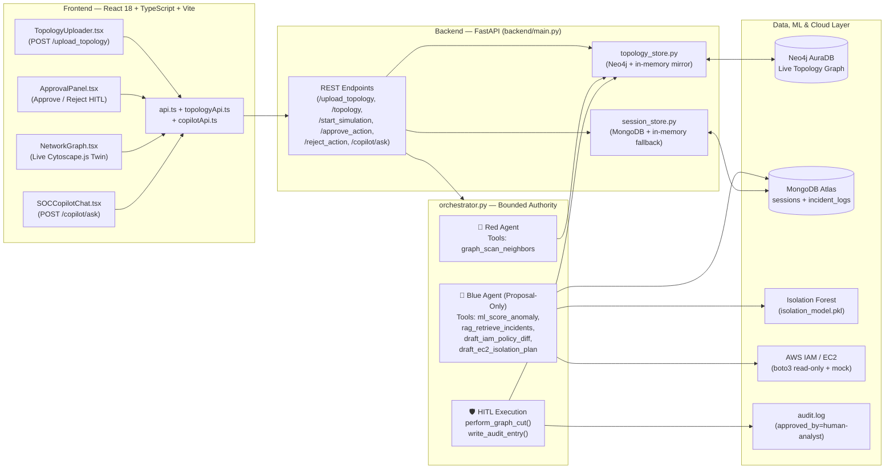
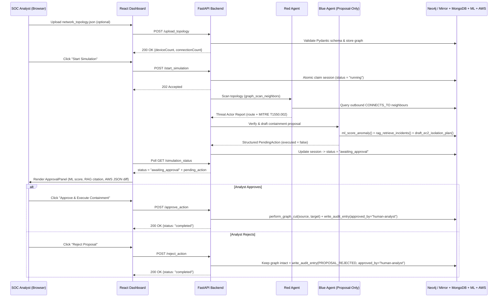
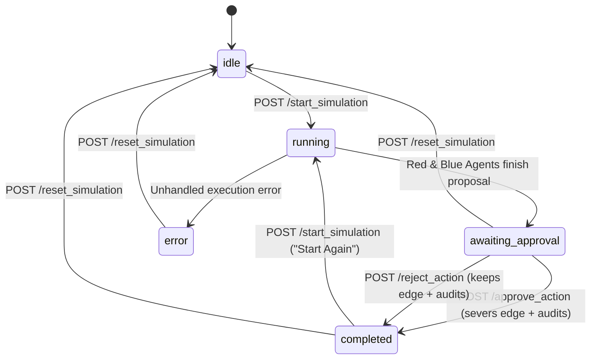

# 🛡️ Project Chronos: AI-Driven Cyber Resilience Digital Twin (v2.0 — Phase 2)

**Live Dashboard:** [https://project-chronos-beryl.vercel.app](https://project-chronos-beryl.vercel.app)

**Live API Endpoint:** [https://project-chronos-cxog.onrender.com](https://project-chronos-cxog.onrender.com)

**Project Documentation:** [https://shorturl.at/dp0JV](https://shorturl.at/dp0JV)

Project Chronos is an autonomous, real-time cyberattack simulation and human-governed incident-response platform. It renders a live "digital twin" of a network, lets an AI **Red Agent** plan and narrate a multi-stage intrusion against it, and lets a bounded-authority AI **Blue Agent** detect, verify via Machine Learning, ground in historical cyber incidents (RAG), draft AWS cloud remediations, and **propose** surgical containment for a **Human-in-the-Loop (HITL) SOC Analyst** to approve or reject.

---

## 📚 Table of Contents

1. [Core Architecture Highlights (Phase 1 + Phase 2)](#-core-architecture-highlights)
2. [Phase 2 Major Upgrades](#-phase-2-major-upgrades)
3. [System Architecture Diagram](#-system-architecture-diagram)
4. [How a Phase 2 Simulation Cycle Works](#-how-a-phase-2-simulation-cycle-works)
5. [Simulation State Machine (with HITL Gate)](#-simulation-state-machine)
6. [Tech Stack](#-tech-stack)
7. [Repository Structure](#-repository-structure)
8. [API Reference (Appendix B)](#-api-reference)
9. [Environment Variable Reference (Appendix A)](#-environment-variable-reference)
10. [Local Development & Automated Pytest Suite](#️-local-development--automated-pytest-suite)
11. [References & Further Reading](#-references--further-reading)
12. [Hackathon Deployment](#-hackathon-deployment)
13. [Team](#-team)

---

## 🚀 Core Architecture Highlights

* **Multi-Agent GenAI Orchestrator:** Powered by **CrewAI** and **Groq** (`llama-3.3-70b-versatile`) with a deterministic tool-pipeline fallback. A **Red Agent** ("Advanced Persistent Threat Simulator") maps multi-stage lateral movement by actively querying the network graph, while a **Blue Agent** ("Autonomous SOAR Analyst — Proposal-Only") mathematically verifies the threat, retrieves historical incident precedent via RAG, drafts AWS IAM/EC2 remediation, and submits a structured containment proposal classified against the **MITRE ATT&CK** framework.
* **Bounded Agent Authority & Human-in-the-Loop (HITL) Governance:** In Phase 2, destructive containment tools (`graph_cut_connection` and `audit_log_action`) are **removed from the Blue Agent's toolset**. The Blue Agent can only analyze and propose; a human analyst must explicitly click **Approve & Execute Containment** (`POST /approve_action`) or **Reject Proposal** (`POST /reject_action`) in the dashboard's `ApprovalPanel`.
* **Dynamic Custom Network Topology Upload & Live Neo4j Digital Twin:** Users can upload any valid `network_topology.json` via `TopologyUploader.tsx` (`POST /upload_topology`), validated against a strict Pydantic graph-integrity contract (`NetworkTopologyFile`), persisted to **Neo4j AuraDB** (and an always-available in-memory mirror), and rendered live in Cytoscape.js via `GET /topology`.
* **Persistent MongoDB Session Store & Vector RAG Corpus:** Simulation state is persisted in **MongoDB Atlas** (`backend/db/session_store.py`) with atomic `find_one_and_update` locking so concurrent `/start_simulation` requests return `409 Conflict` cleanly. Historical incident write-ups (16 starter incidents with 768-dimensional L2-normalized embeddings) are stored in `incident_logs` and queried via `@tool("rag_retrieve_incidents")` with reference-only prompt-injection delimiters.
* **AWS Cloud Remediation Drafting (`boto3`):** The Blue Agent calls `draft_iam_policy_diff` and `draft_ec2_isolation_plan` (`backend/tools/aws_tools.py`) to inspect IAM role policies / EC2 security groups and produce a before/after JSON remediation plan with `executed: false`.
* **GenAI SOC Copilot (`POST /copilot/ask`):** Analysts can ask natural-language questions about the live network topology in `SOCCopilotChat.tsx`. Questions are translated to read-only Cypher, verified by a strict server-side validator (`validate_cypher`) that blocks any write/mutation keyword (`CREATE`, `MERGE`, `DELETE`, `DETACH`, `SET`, `REMOVE`, `DROP`, `CALL`, etc.) with HTTP `422`, and executed in a read-only session.

---

## ✨ Phase 2 Major Upgrades

| Capability | Phase 1 Baseline | Phase 2 Upgrade |
|---|---|---|
| **Network Topology** | Static 5-node frontend mock / 19-node seeded file | Custom `.json` upload (`POST /upload_topology`), Pydantic graph integrity check, live `GET /topology` sync |
| **Session State** | In-memory Python dict (`SIMULATION_STATE`) | Persistent MongoDB `sessions` collection (`session_store.py`) + atomic start lock + offline fallback |
| **Blue Agent Grounding** | ML anomaly score only | ML score + **RAG Historical Incident Retrieval** (`768-dim` vectors, 16-incident corpus, anti-injection delimiters) |
| **Containment Governance** | Autonomous agent execution | **Mandatory Human-in-the-Loop (HITL) Gate** (`awaiting_approval`, `ApprovalPanel.tsx`, `/approve_action`, `/reject_action`) |
| **Cloud Remediation** | Graph edge cut only | **AWS IAM Policy Diff & EC2 Isolation Plan Drafting** (`boto3`, `executed: false` safety boundary) |
| **Analyst Investigation** | Static node inspector | **GenAI SOC Copilot** (`SOCCopilotChat.tsx`, NL-to-Cypher + read-only Cypher validator) |

---

## 🗺 System Architecture Diagram



---

## 🔄 How a Phase 2 Simulation Cycle Works



---

## 🔁 Simulation State Machine



---

## 🧰 Tech Stack

| Layer | Technology | Purpose |
|---|---|---|
| Frontend framework | React 18 + TypeScript + Vite 6 | SOC Dashboard, HITL Approval Panel, Topology Uploader, Copilot Chat |
| Graph visualization | [Cytoscape.js](https://js.cytoscape.org/) (`react-cytoscapejs`) | Live network digital twin rendering & status overlays |
| Backend framework | [FastAPI](https://fastapi.tiangolo.com/) + Pydantic (v1/v2 dual-compatible) | REST API, schema validation, HITL concurrency lock |
| Agent orchestration | [CrewAI](https://docs.crewai.com/) + Deterministic Pipeline | Red vs Blue multi-agent reasoning & bounded tool execution |
| LLM provider | [Groq](https://groq.com/) (`llama-3.3-70b-versatile`) via LiteLLM | Agent reasoning & NL-to-Cypher translation |
| Graph database | [Neo4j AuraDB](https://neo4j.com/cloud/aura/) + In-Memory Mirror | Network topology storage, neighbour traversal, edge severing |
| Document & Vector DB | [MongoDB Atlas](https://www.mongodb.com/atlas) + `mongomock` / In-Memory Fallback | Session state persistence (`sessions`) & RAG vector store (`incident_logs`) |
| RAG Embeddings | `scikit-learn` HashingVectorizer + NumPy (`768-dim` L2-normalized) | 100% local, deterministic semantic + character n-gram embeddings |
| Cloud Remediation | `boto3` (`iam`, `ec2`) | Read-only AWS IAM policy diff & EC2 quarantine security-group drafting |
| ML Engine | `scikit-learn` `IsolationForest` + `joblib` | Unsupervised anomaly detection (`isolation_model.pkl`) |

---

## 🗂 Repository Structure

```text
Project_Chronos/
├── README.md
├── conftest.py                         # Root pytest path bootstrap
├── sample_data/
│   └── network_topology.json           # Sample 6-device topology for upload testing
├── backend/
│   ├── _bootstrap.py                   # Dual-mode sys.path & Starlette/httpx testclient shim
│   ├── main.py                         # FastAPI v2.0.0 app — HITL endpoints, lifespan, health, audit logs
│   ├── orchestrator.py                 # Bounded Red/Blue agents, tools, HITL perform_graph_cut & audit writer
│   ├── requirements.txt                # Full backend dependencies
│   ├── .env.example                    # Template for all Phase 2 environment variables
│   ├── audit.log                       # Immutable compliance trail (records approved_by)
│   ├── schemas/
│   │   └── topology.py                 # Pydantic v1/v2 compatible NetworkTopologyFile schema
│   ├── db/
│   │   ├── mongo.py                    # MongoDB client with automatic mongomock / in-memory fallback
│   │   ├── neo4j_driver.py             # Lazy, failure-tolerant shared Neo4j driver with TTL caching
│   │   ├── session_store.py            # Atomic MongoDB session state management
│   │   └── topology_store.py           # Unified Neo4j + in-memory topology mirror
│   ├── routes/
│   │   ├── topology.py                 # POST /upload_topology & GET /topology
│   │   └── copilot.py                  # POST /copilot/ask
│   ├── rag/
│   │   ├── embeddings.py               # 768-dim deterministic L2-normalized text embedder
│   │   ├── ingest_incidents.py         # 16 starter cyber incidents & chunk/seed CLI
│   │   └── retrieve.py                 # @tool("rag_retrieve_incidents") with safety delimiters
│   ├── tools/
│   │   └── aws_tools.py                # @tool("draft_iam_policy_diff") & @tool("draft_ec2_isolation_plan")
│   ├── copilot/
│   │   ├── nl_to_cypher.py             # NL-to-Cypher prompt & read-only validate_cypher() guard
│   │   ├── offline.py                  # Rule-based NL-to-Cypher & mirror query engine
│   │   ├── answer.py                   # End-to-end question answering (Groq/Neo4j or offline mirror)
│   │   └── test_copilot_validator.py   # Cypher validator unit tests
│   ├── graph_db/
│   │   ├── ai_glasses.py               # Phase 1 Neo4j helper functions
│   │   ├── ingest_topology.py          # Single-transaction Neo4j graph ingestion & reader
│   │   └── network_topology.json       # Default 19-device enterprise network topology
│   ├── ml_engine/
│   │   ├── detect.py                   # Isolation Forest anomaly scorer
│   │   ├── defense_logger.py           # DefenseLogger with Phase 2 approved_by support
│   │   └── isolation_model.pkl         # Pre-trained IsolationForest model
│   └── tests/
│       ├── test_rag_pipeline.py        # 8 tests for RAG ingestion, embeddings, and safety block
│       ├── test_topology_schema.py     # 4 tests for Pydantic graph integrity validation
│       ├── test_session_store.py       # 4 tests for MongoDB session store concurrency & reset
│       └── test_phase2_backend_e2e.py  # 22 end-to-end tests covering all Phase 2 endpoints
└── frontend/
    ├── index.html, vite.config.ts, tsconfig*.json, package.json
    ├── .env.example                    # VITE_API_BASE_URL, VITE_USE_MOCK_DATA, VITE_POLLING_INTERVAL
    └── src/
        ├── main.tsx, App.tsx           # Full Phase 2 dashboard integration
        ├── types/
        │   ├── simulation.ts           # SimulationData, PendingAction, TopologyDevice, etc.
        │   └── topology.types.ts       # Re-exported topology contracts
        ├── services/
        │   ├── api.ts                  # Unified REST + mock client (status, topology, HITL approve/reject)
        │   ├── topologyApi.ts          # Upload & error-formatting helpers
        │   ├── copilotApi.ts           # POST /copilot/ask client + offline mock translator
        │   └── mockSimulation.ts       # Realistic offline simulation with HITL awaiting_approval pause
        ├── utils/
        │   └── topologyToCytoscape.ts  # Pure converter from NetworkTopologyFile to Cytoscape elements
        ├── components/
        │   ├── ApprovalPanel.tsx       # Phase 2 HITL Containment Governance Banner
        │   ├── TopologyUploader.tsx    # Phase 2 Custom .json Topology Uploader
        │   ├── SOCCopilotChat.tsx      # Phase 2 GenAI SOC Copilot Chat & Cypher Viewer
        │   ├── NetworkGraph.tsx        # Live-wired Cytoscape.js Digital Twin
        │   ├── LiveNetworkGraph.tsx    # Standalone live topology graph component
        │   ├── Header.tsx, RiskSummary.tsx, SimulationControls.tsx
        │   ├── SimulationTimeline.tsx, NodeDetails.tsx, RemediationQueue.tsx
        │   └── AuditLog.tsx, PlaybookModal.tsx
        └── styles/global.css           # Dark-navy SOC design system
```

---

## 🔌 API Reference

Base URL (local): `http://localhost:8000` · Base URL (live): `https://project-chronos-cxog.onrender.com`

| Method | Endpoint | Description | Response Codes |
|---|---|---|---|
| `GET` | `/` | Health check — uptime, version (`2.0.0`), orchestrator mode, database & Neo4j status | `200 OK` |
| `POST` | `/upload_topology` | Multipart upload (`topology_file`) of a `.json` topology; validates schema & updates mirror + Neo4j | `200 OK` · `400` bad file/JSON · `413` >2MB · `422` schema error |
| `GET` | `/topology` | Returns current `{devices, connections}` from Neo4j (if reachable) or the in-memory mirror | `200 OK` |
| `POST` | `/start_simulation` | Atomically claims session and launches Red-vs-Blue background worker | `202 Accepted` · `409 Conflict` if already `running` or `awaiting_approval` |
| `GET` | `/simulation_status` | Returns current session document including `status` and `pending_action` | `200 OK` |
| `POST` | `/approve_action` | Human analyst approves `pending_action`: severs graph edge, writes `audit.log` (`approved_by=human-analyst`), marks `completed` | `200 OK` · `409 Conflict` if no pending action |
| `POST` | `/reject_action` | Human analyst rejects `pending_action`: leaves graph untouched, writes `PROPOSAL_REJECTED` to `audit.log`, marks `completed` | `200 OK` · `409 Conflict` if no pending action |
| `POST` | `/reset_simulation` | Resets session to `idle` while preserving `cycles_run` | `200 OK` · `409 Conflict` if `running` |
| `POST` | `/copilot/ask` | Translates `{question}` into a validated read-only Cypher query, executes against Neo4j/mirror, and summarizes | `200 OK` · `400` empty question · `422` unsafe/untranslatable query |
| `GET` | `/audit_logs` | Returns recent parsed entries from `backend/audit.log` (`?limit=50`) | `200 OK` |

---

## 🔐 Environment Variable Reference

### Backend (`backend/.env` — see `backend/.env.example`)

| Variable | Required? | Default / Fallback | Description |
|---|---|---|---|
| `GROQ_API_KEY` | Optional | Deterministic tool pipeline | Groq API key for CrewAI LLM mode and SOC Copilot NL-to-Cypher |
| `LITELLM_DROP_PARAMS` | Optional | `True` | Drops unsupported OpenAI params when calling Groq via LiteLLM |
| `CHRONOS_FORCE_DETERMINISTIC` | Optional | `false` | Set to `true` to force deterministic orchestrator execution even if `GROQ_API_KEY` is set |
| `NEO4J_URI` | Optional | In-memory topology mirror | Neo4j AuraDB connection URI (`neo4j+s://...` or `bolt://...`) |
| `NEO4J_USER` | Optional | `neo4j` | Neo4j username |
| `NEO4J_PASSWORD` | Optional | In-memory topology mirror | Neo4j password |
| `MONGODB_URI` | Optional | `mongomock` / In-memory store | MongoDB Atlas connection string for `sessions` and `incident_logs` |
| `MONGODB_DB_NAME` | Optional | `chronos_dev` | Target MongoDB database name |
| `RAG_VECTOR_INDEX_NAME` | Optional | `incident_vector_index` | Atlas Vector Search index name (falls back to exact Python cosine similarity) |
| `RAG_MIN_SIMILARITY` | Optional | `0.15` | Minimum cosine similarity floor (`-1..1`) for retrieved RAG incidents |
| `AWS_ACCESS_KEY_ID` | Optional | Labelled mock policy/SG | AWS credentials for read-only IAM/EC2 inspection |
| `AWS_SECRET_ACCESS_KEY` | Optional | Labelled mock policy/SG | AWS secret key |
| `AWS_DEFAULT_REGION` | Optional | `us-east-1` | AWS region for `boto3` clients |
| `CHRONOS_USE_MOCK_AWS` | Optional | `true` | When `true`, falls back to clearly labelled mock AWS data if AWS is unreachable |

### Frontend (`frontend/.env` — see `frontend/.env.example`)

| Variable | Default | Description |
|---|---|---|
| `VITE_API_BASE_URL` | `http://localhost:8000` | Base URL of the FastAPI backend |
| `VITE_USE_MOCK_DATA` | `false` (live) / `true` (mock) | Set to `false` to connect to the live FastAPI backend |
| `VITE_POLLING_INTERVAL` | `1000` | Polling interval in milliseconds while simulation is `running` or `awaiting_approval` |

---

## ⚙️ Local Development & Automated Pytest Suite

### 1. Run the 47-Test Backend Suite

From the repository root:

```bash
backend\venv\Scripts\python.exe -m pytest -v
```

This executes all 5 test suites (47 tests total) completely offline:
- `backend/tests/test_rag_pipeline.py` (8 tests)
- `backend/tests/test_topology_schema.py` (4 tests)
- `backend/tests/test_session_store.py` (4 tests)
- `backend/copilot/test_copilot_validator.py` (9 tests)
- `backend/tests/test_phase2_backend_e2e.py` (22 tests)

### 2. Start the FastAPI Backend

```bash
cd backend
venv\Scripts\python.exe -m uvicorn main:app --host 127.0.0.1 --port 8000 --reload
```

### 3. Start the React + Vite Frontend

```bash
cd frontend
npm install
npm run dev
```

Open `http://localhost:5173` in your browser.

---

## 📖 References & Further Reading

* [CrewAI Documentation](https://docs.crewai.com/)
* [Groq API Documentation](https://console.groq.com/docs)
* [Neo4j AuraDB Documentation](https://neo4j.com/docs/aura/)
* [MongoDB Atlas Vector Search](https://www.mongodb.com/docs/atlas/atlas-vector-search/vector-search-overview/)
* [MITRE ATT&CK Framework](https://attack.mitre.org/)
* [AWS Boto3 IAM & EC2 Documentation](https://boto3.amazonaws.com/v1/documentation/api/latest/index.html)
* [FastAPI Documentation](https://fastapi.tiangolo.com/)
* [Cytoscape.js Documentation](https://js.cytoscape.org/)

---

## 🏆 Hackathon Deployment

Pushes to the `main` branch automatically trigger production builds across **Vercel** (React/Vite Frontend) and **Render** (FastAPI Web Service).

---

## 👥 Team

Built by **Team Future Builders 2.0**:

| Name | GitHub |
|---|---|
v2(Phase 2)
| Aman Aaryan | [thestethoguy](https://github.com/thestethoguy) |
| Divyansh Shukla | [DivyanshShukla001](https://github.com/DivyanshShukla001) |
| Garv Rai | [garvrai-cloud](https://github.com/garvrai-cloud). |
| Anoushka Saha | [sanoushka](https://github.com/sanoushka) |

v1(Phase 1)
| Aman Aaryan | [thestethoguy](https://github.com/thestethoguy) |
| Sivak Singh | [sivaksingh00](https://github.com/sivaksingh00) |
| Rishabh Kumar | [riszabh](https://github.com/riszabh) |
| Zasefa Kaniz | [Zasefa](https://github.com/Zasefa) |
